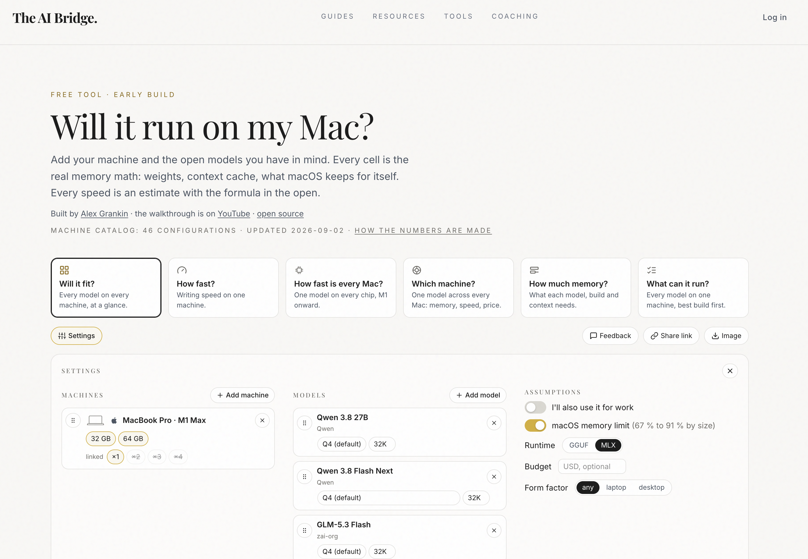
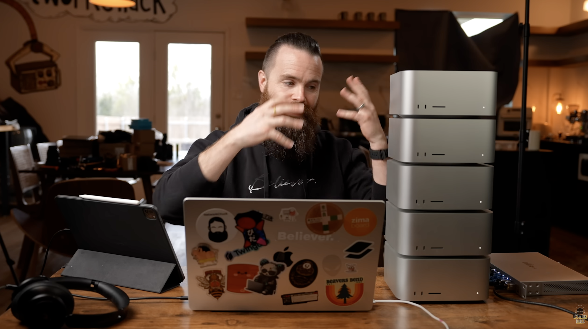
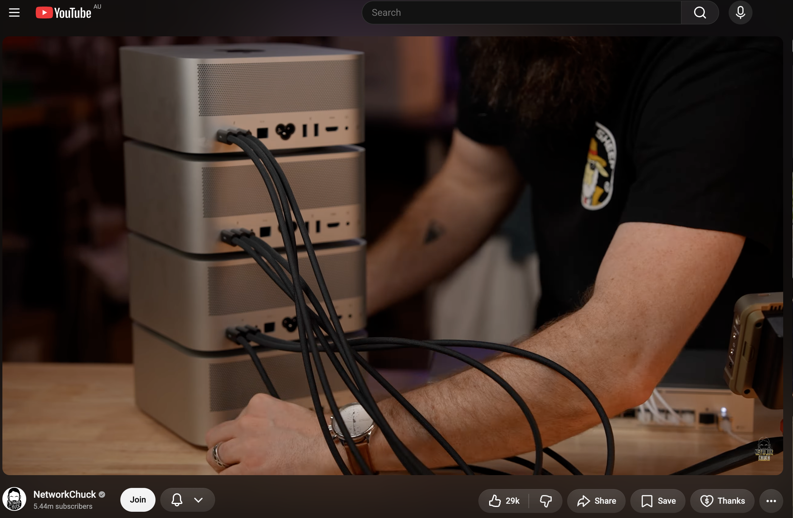
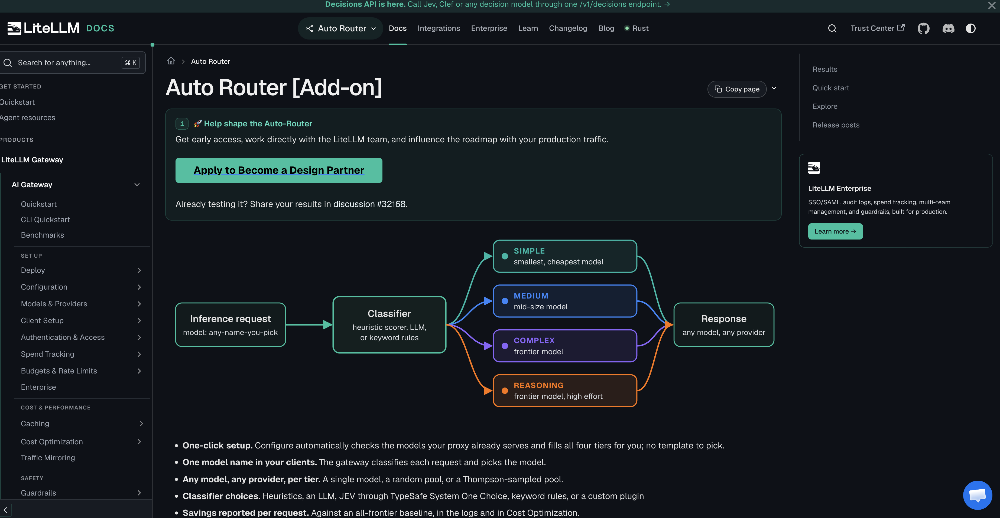

# Huddle AI

Running models on our own machines.

This week

<!--
Open with the week, not the hardware. The point of the huddle is what I have been doing with AI: reading about local models, and building a Linux PC to try them.
-->

---
layout: two-cols
---

# This week

I have been reading about running large language models on machines we control.

::right::

  

    
Reading

    
How a model actually gets onto a machine, and what makes it fast or slow.

  

  

    
Building

    
A Linux PC put together for models and the tools around them.

  

---

# Why bother

  

    
01

    <h3>Experiment</h3>
    
Try tools, formats, and models without waiting on a vendor roadmap.

  

  

    
02

    <h3>Privacy</h3>
    
The prompt, the files, and the answers can stay on hardware we own.

  

  

    
03

    <h3>Cost</h3>
    
A machine has a price. A hosted API keeps charging for every token.

  

---

# What the machine has to have

  

    
VRAM

    
Enough to hold the whole model. If the weights do not fit, it does not run.

  

  

    
RAM

    
Memory bandwidth is what turns into tokens per second.

  

  

    
Disk

    
A fast drive, because loading the model is its own wait.

  

<!--
VRAM is memory on the GPU, not the disk. The disk is the third point: getting the weights off storage and into memory.
-->

---
layout: two-cols
---

# LM Studio

One app. Windows, Mac, and Linux.

Download it, pick a model, and talk to it.

::right::

  

    
GGUF

    
The portable format. This is the one for the Linux PC.

  

  

    
MLX

    
Apple's format. This is the one that suits a Mac.

  

---

# What you switch on

  

    
Tool use

    <h3>Let it act</h3>
    
Search the web, run code, read a file, call an API, or use MCP servers.

  

  

    
Reasoning

    <h3>Let it think</h3>
    
Harder problems, maths, and work that takes more than one step.

  

---

# How big is the file

Weights in GB ≈ parameters, in billions × bytes per weight.

  

    
FP16

    
2 bytes

    
A 70 billion parameter model is about 140 GB.

  

  

    
4-bit

    
0.5 bytes

    
The same model is about 35 GB. Lower resolution, much more likely to fit.

  

<!--
Quantization is the resolution of the weights. The formula is the one in the notes. The 70B example is just the formula applied, so the room can feel the difference.
-->

---
layout: two-cols
---

# Will it fit?

Before downloading a model, check the memory maths.

The AI Bridge does that in the open: weights, context, and what the machine keeps for itself.

::right::

---

# Then you load it

  

    
In LM Studio

    <h3>A chat on the desk</h3>
    
Load the model and show a normal conversation, running locally.

  

  

    
In Claude

    <h3>A local override</h3>
    
Point the config at the machine in the room instead of the hosted API.

  

<!--
Live demo. First the LM Studio chat. Then the Claude config that overrides the remote endpoint with the local one.
-->

---

# Other ways to build it

  

    
Buy

    <h3>NVIDIA DGX Spark</h3>
    
A small NVIDIA machine aimed at this job.

  

  

    
Build

    <h3>An AI server rack</h3>
    
The same idea as the desk PC, taken out of the office and into a rack.

  

---
layout: two-cols
---

# A stack of Mac Studios

One machine is a computer.

A stack is a bigger pool of memory, still on the desk.

::right::

---
layout: two-cols
---

# Tie them together

The cables are the point.

RDMA lets one Studio read another's memory directly, instead of copying every token across a normal network.

::right::

  

---

# Tokens per second

Same kind of comparison: how many tokens come back each second.

| Where it runs | Tokens / sec |
| --- | --- |
| Anthropic / ChatGPT | 100 |
| RTX 5090 | 50–70 |
| Top-spec Mac Studio | 40–70 |
| NVIDIA DGX Spark | 50–70 |
| Mac Studio cluster | Shared over RDMA |

<!--
These are the figures from this week's notes, for the same model and quantization. The cluster is not given a single number. The point of the cluster is RDMA, not a faster single box.
-->

---
layout: two-cols
---

# What I want to try next

  
n8n

  <h3>Whole workflows</h3>
  
Not one chat. A run of steps that can call the model and then do the work.

::right::

  
LiteLLM

  <h3 class="mb-4">Send the hard calls out</h3>
  

<!--
The diagram is LiteLLM's auto router. A request comes in, a classifier picks a tier, and the answer can come from a small local model or a frontier model somewhere else.
-->

---
layout: center
class: text-center
---

# One final thing

There are 24 hours in a day.

We can.

<!--
The notes stop on "We can." Finish the sentence in the room.
-->
